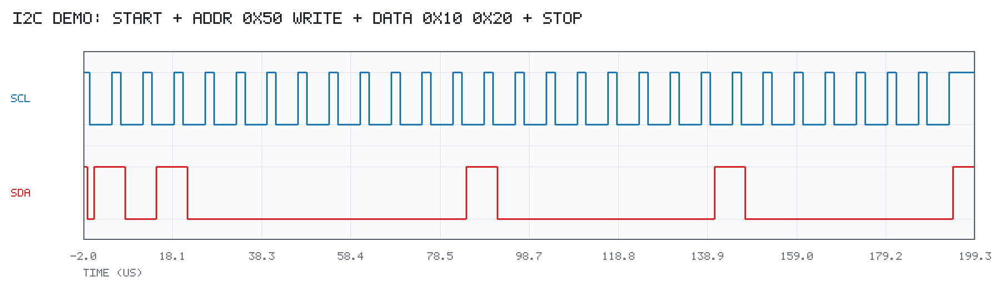
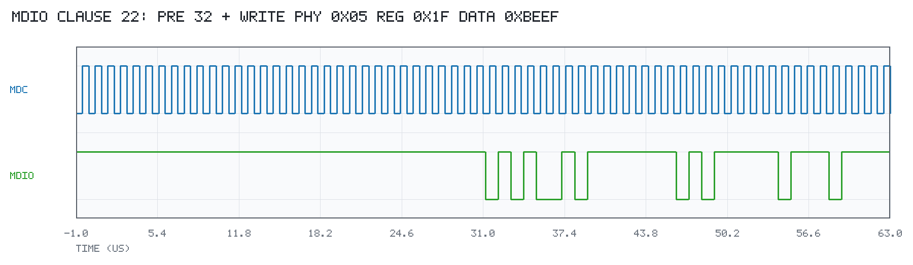
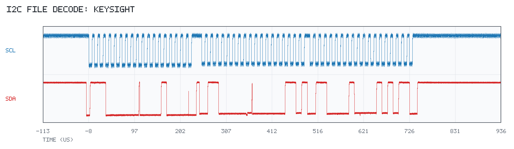
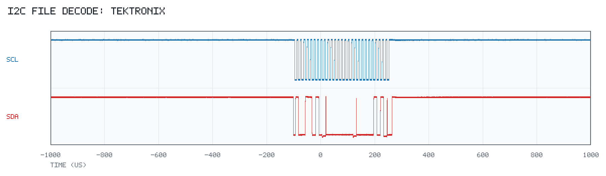

# decode 使用文档

`github.com/jkbhuan/go-decode` 是一个独立、纯 Go 的协议解码与波形接入库。它不连接仪器、
不依赖 VISA，也不负责 JSON 序列化；所有结果都是强类型 Go 结构体。

- 总线：I²C、IEEE 802.3 Clause 22 SMI/MDIO
- 波形来源：调用方内存中的 `Waveform`、Keysight/Tektronix SCPI、Keysight
  `.bin`、Tektronix `.wfm`
- 相关文档：[README](../README.md) · [开发报告](../DEVELOPMENT_REPORT.md)

---

## 目录

1. [模块边界](#1-模块边界)
2. [内存波形直接解码](#2-内存波形直接解码)
3. [Keysight SCPI 完整示例](#3-keysight-scpi-完整示例)
4. [Tektronix SCPI](#4-tektronix-scpi)
5. [保存文件与 raw payload](#5-保存文件与-raw-payload)
6. [强类型结果](#6-强类型结果)
7. [时序选择与光标](#7-时序选择与光标)
8. [示例波形图](#8-示例波形图)
9. [支持矩阵与错误](#9-支持矩阵与错误)
10. [测试与验证状态](#10-测试与验证状态)

---

## 1. 模块边界

```text
github.com/jkbhuan/go-decode（Facade：decode.I2C / decode.SMI / 类型别名；无仪器/文件 I/O）
  ├── core                Waveform/Capture/边沿/时序/诊断（不依赖总线/VISA）
  ├── bus/i2c             I²C 7-bit 状态机与时序
  ├── bus/smi             MDIO Clause 22 状态机与时序
  ├── scope               IEEE 488.2 Block 解析（纯数据）
  │   ├── keysight        preamble、payload、AG10 .bin 解析
  │   └── tektronix       WFMOutpre、CURVe? payload、WFM#002/#003 .wfm 解析
  ├── fileio              调用方提供的 io.ReaderAt 格式路由、raw payload
  └── compat.go           旧符号转发（Deprecated）

本仓库之外（原工程中的上层程序）：
cmd/keysight-i2c-decode    Keysight VISA/SCPI 实时读取 → decode.I2C
cmd/tektronix-i2c-decode   Tektronix VISA/SCPI 实时读取 → decode.I2C
wavefile                   打开保存文件后交给 fileio 解析
```

边界规则：decode 只接收调用方已经取得的 `Waveform`、响应字节、payload 或
`io.ReaderAt`；不打开文件、不创建 VISA Session、不发送任何 SCPI 命令。
实时 SCPI 代码没有独立采集包，全部直接写在两个 cmd 示例里，便于逐步看到
`Query`/`WriteString`/`QueryBinaryBlock` 的命令和响应。

依赖方向：`fileio → scope/* → core`，`bus/* → core`；`core` 不导入上层。
`decode` 根包不导入 fileio 或 go-visa；需要操作仪器的示例都在 `cmd/`。

单位始终是**秒**和**伏特**；`StartTime` 是第 0 个采样点在仪器水平时间轴上的
坐标，不是 Unix 时间戳。`Timing.X1/X2` 保持绝对仪器时间，不会因裁剪/窗口归零。

---

## 2. 内存波形直接解码

```go
import "github.com/jkbhuan/go-decode"

res, err := decode.I2C(scl, sda, decode.I2COptions{
    SCLThreshold: decode.LogicThreshold{Low: 0.99, High: 2.31},
    SDAThreshold: decode.LogicThreshold{Low: 0.99, High: 2.31},
    VDD:          3.3,
})
if err != nil { /* ... */ }

for _, f := range res.Frames {
    // f.Address, f.Direction, f.AddressACK, f.Data
}
for _, tm := range res.Timings {
    // tm.Name, tm.Value, tm.X1, tm.X2
}

smiRes, err := decode.SMI(mdc, mdio, decode.SMIOptions{
    MDCThreshold:    decode.LogicThreshold{Low: 0.8, High: 2.0},
    MDIOThreshold:   decode.LogicThreshold{Low: 0.8, High: 2.0},
    TimingThreshold: &decode.LogicThreshold{Low: 0.8, High: 2.0},
})
```

`decode.DecodeI2C` / `decode.DecodeSMI` 仍保留为 Deprecated 转发；新代码用
`decode.I2C` / `decode.SMI`。总线包也可直接调用：
`i2c.Decode(scl, sda, i2c.Options{...})`、`smi.Decode(mdc, mdio, smi.Options{...})`。

---

## 3. Keysight SCPI 完整示例

`cmd/keysight-i2c-decode` 演示完整流程：cmd 打开 go-visa Session，直接使用
`Query` / `WriteString` / `QueryBinaryBlock` 读取 CHAN1/CHAN2，打印每条 SCPI
命令和响应，然后交给 `decode.I2C` 解码并保存 PNG。实时读取代码全部在该 cmd
中，没有独立的公共采集包；decode 只接收已经取得的波形。

运行命令：

```bash
go run ./cmd/keysight-i2c-decode \
  -addr 10.42.71.194 \
  -window-start 1.25e-3 -window-duration 200e-6 \
  -logic-low 0.99 -logic-high 2.31 -vdd 3.3
```

示例直接发送并记录以下命令：

- `*IDN?`，根据返回的型号区分 Infiniium / InfiniiVision；
- `:STOP` 和 `*OPC?`（仅 `-freeze=true`）；
- `:WAVeform:FORMat WORD`、`:WAVeform:BYTEorder LSBFirst`；
- `:WAVeform:SOURce CHAN1/CHAN2`；
- `:WAVeform:PREamble?`、`:WAVeform:POINts?`、`:WAVeform:DATA?`；
- 窗口使用 1-based `:WAVeform:DATA? start,size` 并修正 `XOrigin`；
- `-restore=true` 时读取前保存并恢复源/格式/字节序/unsigned。

输出默认是结构体摘要；`-json` 只是上层 `json.Marshal` 演示。

完整流程（所有仪器代码都在 `cmd/keysight-i2c-decode/main.go`；下面只展示关键步骤）：

```go
// 1. cmd 打开 VISA Session，decode 不参与
s, err := visa.Open(ctx, "TCPIP0::10.42.71.194::hislip0::INSTR",
    visa.WithTimeout(timeout),
    visa.WithMaxReadBytes(maxResponse),
)
if err != nil {
    log.Fatal(err)
}
defer s.Close()

// 2. 直接使用 Session.Query / WriteString / QueryBinaryBlock
idn, _ := s.Query(ctx, "*IDN?")
fmt.Println("RX *IDN?", idn)

s.WriteString(ctx, ":STOP")
s.WriteString(ctx, ":WAVeform:FORMat WORD")
s.WriteString(ctx, ":WAVeform:BYTEorder LSBFirst")
s.WriteString(ctx, ":WAVeform:SOURce CHAN1")

pre, _ := s.Query(ctx, ":WAVeform:PREamble?")
pts, _ := s.Query(ctx, ":WAVeform:POinTS?")
payload, _ := s.QueryBinaryBlock(ctx, ":WAVeform:DATA?")

// 3. 复用 decode/scope/keysight 的纯像素解析（不发命令）
p, _, _ := keysight.ParsePreamble(stripHeader(pre))
scl, _ := keysight.FormatWaveform(payload, p,
    keysight.SampleEncoding{BytesPerPoint: 2, Signed: true, ByteOrder: "LSBF"})
_ = pts

// CHAN2 重复上面的 SOURce/PREamble/POinTS/DATA?，得到 sda

// 4. 纯解码：只接收已经取得的 Waveform
res, err := decode.I2C(scl, sda, decode.I2COptions{
    SCLThreshold: decode.LogicThreshold{Low: 0.99, High: 2.31},
    SDAThreshold: decode.LogicThreshold{Low: 0.99, High: 2.31},
    VDD:          3.3,
})
```

完整示例还包含：`*IDN?` 型号识别、读取前保存并恢复
`:WAVeform:SOURce/FORMat/BYTEorder/UNSigned`、可选窗口
`:WAVeform:DATA? start,size`、点数和响应长度保护、PNG 输出和 JSON 输出。
运行时 stderr 会打印每一步：

```text
SCPI TX  *IDN?
SCPI RX  KEYSIGHT TECHNOLOGIES,MXR604A,...
SCPI TX  :WAVeform:SOURce CHAN1
SCPI TX  :WAVeform:PREamble?
SCPI RX  +2.00000000E+00,...
SCPI TX  :WAVeform:DATA?
SCPI RX  <binary block 80000000 bytes; head=...>
```

---

## 4. Tektronix SCPI

泰克 4/5/6-Series MSO 使用 `TCPIP0::<addr>::inst0::INSTR` 连接。完整示例是
`cmd/tektronix-i2c-decode/main.go`，所有实时代码都写在这个 cmd 里，直接调用
`go-visa` 的 `Query`、`WriteString`、`QueryBinaryBlock`，并打印每条命令和响应。

```bash
go run ./cmd/tektronix-i2c-decode \
  -addr 192.168.1.100 \
  -scl-channel CH1 -sda-channel CH2 \
  -logic-low 0.99 -logic-high 2.31 -vdd 3.3
```

命令顺序依据 `4-5-6-Series-MSO_Programmer.pdf` 的
“Transferring waveform data from the instrument”：

1. `:DATa:SOUrce` 选择波形源；
2. `:DATa:ENCdg SRIbinary` 指定有符号整数、小端；
3. `:DATa:WIDth 2` 指定每点 2 字节；
4. `:HORizontal:RECOrdlength?` 获取记录长度，`:DATa:STARt 1` /
   `:DATa:STOP <record>` 指定完整范围，再用 `:WFMOutpre:NR_Pt?` 确认点数；
5. `:WFMOutpre?` 获取缩放和时间轴参数；
6. `:CURVe?` 传输数据。

关键代码：

```go
s, err := visa.Open(ctx, "TCPIP0::192.168.1.100::inst0::INSTR",
    visa.WithTimeout(timeout),
    visa.WithMaxReadBytes(maxResponse),
)
if err != nil {
    log.Fatal(err)
}
defer s.Close()

idn, _ := s.Query(ctx, "*IDN?")
fmt.Println("RX *IDN?", idn) // TEKTRONIX,MSO64B,...

s.WriteString(ctx, "ACQuire:STATE STOP")
s.Query(ctx, "*OPC?")

s.WriteString(ctx, ":DATa:SOUrce CH1")
s.WriteString(ctx, ":DATa:ENCdg SRIbinary")
s.WriteString(ctx, ":DATa:WIDth 2")

record, _ := s.Query(ctx, ":HORizontal:RECOrdlength?")
s.WriteString(ctx, ":DATa:STARt 1")
s.WriteString(ctx, fmt.Sprintf(":DATa:STOP %s", stripHeader(record)))
nr, _ := s.Query(ctx, ":WFMOutpre:NR_Pt?") // 确认实际传输点数

pre, _ := s.Query(ctx, ":WFMOutpre?")
payload, _ := s.QueryBinaryBlock(ctx, ":CURVe?")

p, _ := tektronix.ParseWFMOutpre(pre)
enc, _ := p.EncodingSpec()
w, _ := tektronix.FormatWaveform(payload, p, enc)
```

换算公式：

```text
V = ((raw - YOff) * YMult) + YZero
t = XZero + (i - PTOffset) * XIncr
```

CH2 重复同样的 `:DATa:SOUrce` 到 `:CURVe?` 流程。采集结束后示例会恢复
`:DATa:SOUrce`、`:DATa:ENCdg`、`:DATa:WIDth`、`:DATa:STARt`、`:DATa:STOP`。
运行输出同样会逐条显示：

```text
SCPI TX  *IDN?
SCPI RX  TEKTRONIX,MSO64B,...
SCPI TX  ACQuire:STATE STOP
SCPI TX  :DATa:SOUrce CH1
SCPI TX  :DATa:ENCdg SRIbinary
SCPI TX  :DATa:WIDth 2
SCPI TX  :HORizontal:RECOrdlength?
SCPI RX  3125000
SCPI TX  :DATa:STARt 1
SCPI TX  :DATa:STOP 3125000
SCPI TX  :WFMOutpre:NR_Pt?
SCPI RX  3125000
SCPI TX  :WFMOutpre?
SCPI RX  :WFMOUTPRE:BYT_NR 2;...
SCPI TX  :CURVe?
SCPI RX  <binary block 6250000 bytes; head=...>
```

本轮实时路径不做窗口下载；需要窗口时请修改示例中的
`:DATa:STARt` / `:DATa:STOP` 并自行处理时间轴。无泰克实机，实时命令序列已按
手册实现并通过编译检查，尚未做实机验收。

---

## 5. 保存文件与 raw payload

```go
// 打开文件属于 wavefile（decode 之外）。
cap, err := wavefile.Open("capture.bin", fileio.Options{
    MaxBytes: 512 << 20, MaxPoints: 10_000_000, ChannelHint: "CH1",
})
w1, ok := cap.Channel("Channel 1", 0)
```

`wavefile.Open` 打开文件后调用 `decode/fileio.Read`；后者只在调用方提供的
`io.ReaderAt` 上按文件头路由，不依赖扩展名，也不打开文件：

| 文件 | 状态 |
| --- | --- |
| Keysight `.bin`（AG10，normal float32） | 支持多 waveform/segment，Peak/数字 buffer 明确拒绝 |
| Tektronix `.wfm`（WFM#002/#003，normal YT） | 支持 LE/BE、有效采样区；FastFrame/envelope 明确拒绝 |
| Keysight 原生 `.wfm` | 明确 unsupported，不猜测 |
| Tektronix CSV | 本轮未实现 |
| 原始 SCPI `.bin` | `fileio.Read` 明确拒绝；必须 `fileio.ReadRaw` |

```go
// 原始负载没有可信的 Preamble/编码，必须显式提供。
cap, err := fileio.ReadRaw(payload, fileio.RawMetadata{
    Preamble: keysight.Preamble{XIncrement: 1e-9, XOrigin: 0, YIncrement: 1e-3},
    Encoding: keysight.SampleEncoding{BytesPerPoint: 2, Signed: true, ByteOrder: "little"},
    Channel:  "CH1",
})
```

命令行文件分析：

```bash
go run ./cmd/decode-file -file capture.bin -ch1 "Channel 1" -ch2 "Channel 2" -protocol i2c
go run ./cmd/decode-file -file scl.wfm -file2 sda.wfm -ch1 CH1 -ch2 CH2 -protocol i2c
```

### 5.1 生产文件 → I²C 时序与 PNG

`cmd/i2c-file-decode` 是面向已保存文件的完整示例：分别传入 SCL/SDA 文件，
打印事务、帧、字节和每个时序候选（值、X1、X2、byte/bit/phase），并用 Go
标准库渲染 PNG。该命令不需要 VISA 或仪器连接；`wavefile.Open` 负责打开
文件，`fileio.Read` 只在取到的数据流上识别格式。

```bash
# Keysight MXR604A AG10 .bin（每通道一个文件，标签 Channel 1/Channel 2）
go run ./cmd/i2c-file-decode \
  -scl "生产环境测试/i2c-keysight/scl.bin" \
  -sda "生产环境测试/i2c-keysight/sda.bin" \
  -png docs/images/keysight_bin_i2c.png

# Tektronix WFM#003 .wfm（每通道一个文件）
go run ./cmd/i2c-file-decode \
  -scl "生产环境测试/i2c-tek/scl.wfm" \
  -sda "生产环境测试/i2c-tek/sda.wfm" \
  -scl-channel CH1 -sda-channel CH2 \
  -png docs/images/tektronix_wfm_i2c.png
```

真实样例结果：

| 样例 | 解码结果 |
| --- | --- |
| Keysight `scl.bin` / `sda.bin` | 2 transactions、3 frames：`0x70 write 0x08`、`0x30 write 0x03`、`0x30 read 0x15`（NACK）；159 timings |
| Tektronix `scl.wfm` / `sda.wfm` | 1 transaction、1 frame：`0x4D write`，数据 `0x00 0x05`；81 timings |

常用参数：`-scl-channel`（默认 `Channel 1`）、`-sda-channel`（默认
`Channel 2`）、`-logic-low 0.99`、`-logic-high 2.31`、`-vdd 3.3`（设 `0`
关闭 I²C 时序）、`-segment`、`-max-points`、`-png`（空字符串关闭）。
对于单通道文件（例如泰克每通道一个 `.wfm`），如果标签不匹配，程序会回退到
该 segment 的唯一记录，因此 `CH1`/`CH2` 只是标签提示，不改变文件路由。

---

## 6. 强类型结果

```go
type I2CResult struct {
    Transactions   []I2CTransaction
    Frames         []I2CFrame
    Timings        []Timing
    SCLFrequencies []FrequencyMeasurement
    Diagnostics    []Diagnostic
}

type I2CFrame struct {
    TransactionIndex int
    Address          uint16
    AddressBits      uint8
    Direction        Direction
    AddressACK       ACKStatus
    Data             []I2CByte
    Start            float64
    End              float64
    HasStop          bool
    RepeatedStart    bool
    Complete         bool
}

type SMIResult struct {
    Frames      []SMIFrame
    Timings     []Timing
    Diagnostics []Diagnostic
}

type Timing struct {
    Name             TimingName
    Value            float64 // 秒
    X1               float64 // 秒
    X2               float64 // 秒
    TransactionIndex int
    FrameIndex       int
    ByteIndex        int
    BitIndex         int
    Phase            string
    Direction        Direction
}
```

- `res.Frames`、`res.Timings` 是直接可遍历的强类型视图；I²C 的
  `TransactionIndex` 指回 `Transactions`，SMI 的 `FrameIndex` 指回 `Frames`。
- `Value == X2-X1`；`Value=0` 合法；未测到的指标以缺失 Timing + Diagnostic 表示。
- `Direction`/`ACKStatus`/`ValidationStatus` 实现 `String()`，可直接打印。
- decode 不做 JSON：需要时上层 `json.Marshal(res)`；自定义字段名请在上层 DTO 转换。

---

## 7. 时序选择与光标

```go
tm, ok := decode.SelectTiming(res.Timings, decode.TimingFilter{
    Name:      decode.TimingSUDAT,
    Direction: decode.DirectionWrite,
    Phase:     "data",
}, decode.SelectMin)
if ok {
    // 仪器层用 tm.X1 / tm.X2（秒）设置光标
}
```

`SelectFirst` 取最早 X1；`SelectMin/Max` 取最小/最大 Value，并列取最早 X1。
没有候选返回 false。写光标前确认仍是同一采集记录，并按型号核对 `:MARKer` 命令。

---

## 8. 示例波形图





生产环境保存文件解码结果：





示例：

```bash
go run ./examples/i2c -png examples/i2c/example_waveform.png
go run ./examples/smi -png examples/smi/example_waveform.png
```

---

## 9. 支持矩阵与错误

| 能力 | 状态 |
| --- | --- |
| I²C/SMI 纯算法 | 已实现、离线验证 |
| Keysight 实时 SCPI | 已实现（`cmd/keysight-i2c-decode` 直接调用 VISA）；波形换算已在 MXR604A 实机验证 |
| Tektronix 实时 SCPI | 已实现（`cmd/tektronix-i2c-decode`，`inst0::INSTR`）；编译通过，无实机 |
| Keysight .bin AG10 | 已实现；真实 scl/sda.bin 解码出 I²C |
| Tektronix .wfm WFM#002/#003 | 已实现；真实 scl/sda.wfm 解码出 I²C |
| Keysight .wfm / Tektronix CSV | 明确不支持/未实现 |
| 原始 SCPI payload | 显式 Preamble+Encoding 后可读，无元数据拒绝 |

常见错误：配置/波形非法返回 `error`；文件格式/版本/采集类型问题使用
`core.ErrUnknownFormat`、`ErrUnsupportedFormatVersion`、
`ErrUnsupportedAcquisitionType`、`ErrFileTooLarge`、`ErrTooManyPoints`，可用
`errors.Is` 判断。采集截断、协议异常和不可测指标仍用 `Diagnostic`。

---

## 10. 测试与验证状态

```bash
go test ./...
go vet ./...
go test -run '^$' -bench . ./...
```

- 真实 Keysight `.bin` 和 Tektronix `.wfm` 样例已在离线测试中解码出 I²C。
- Keysight MXR604A 的 SCPI 波形换算此前做过实机只读验证；真实 I²C/MDIO 总线
  验收仍未进行。
- Tektronix 实时 SCPI 示例按 4/5/6-Series 手册实现并通过编译；未实机。
- FastFrame、Peak/Envelope、Keysight `.wfm`、Tektronix CSV 明确未支持。
